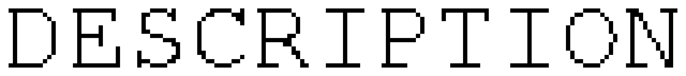

# vassilok

|  |
|:---:|

 
It's well-based program is intented for flexiable plotting geometry tasks and to building geometry constructuins by voice commands

# preposed supported languages: 
 - english
 - russian
